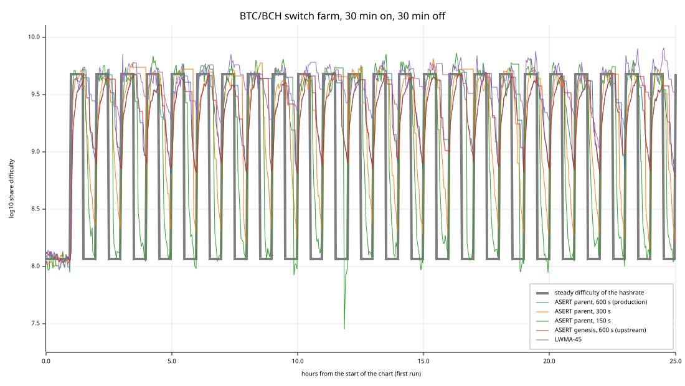
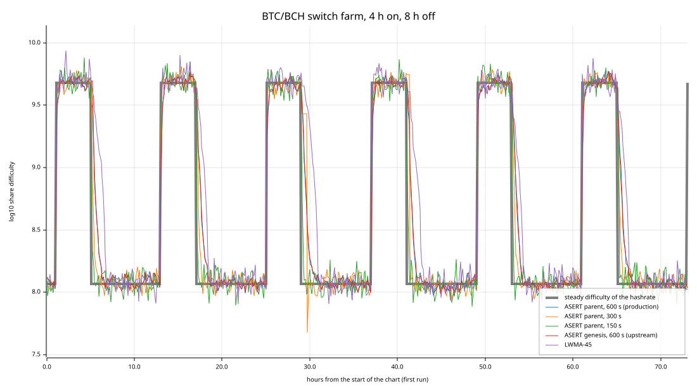
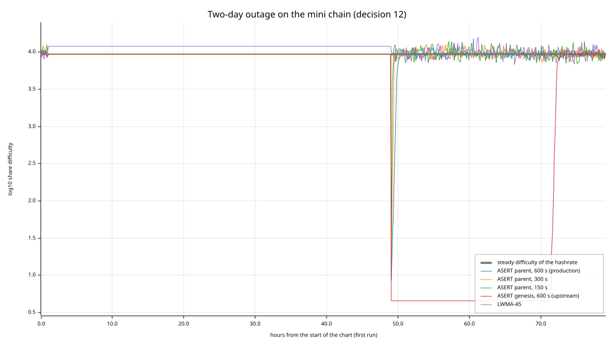
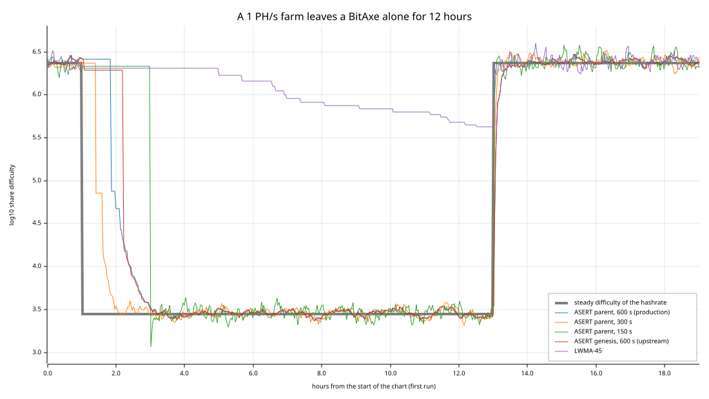

# Share Difficulty Adjustment on the Bitcoin Cash Share Chain

This page reruns upstream's comparison of difficulty adjustment algorithms
for the share chain
([`p2poolv2/pool_difficulty_adjustment_analysis`](https://github.com/p2poolv2/pool_difficulty_adjustment_analysis))
with this fork's own share-difficulty code, and adds the cases that matter on
Bitcoin Cash: miners switching between BTC and BCH, a pool growing from one
BitAxe to exahashes, and long quiet periods. The simulator is the Rust crate
`p2poolv2_daa` (binary `daa_sim`, run as `cargo daa-sim`).

Nothing here changes a share-chain rule. The recommendations are proposals
only.

Every number on this page comes out of a simulation: it is an estimate from
the model described under [Method](#method), not a measurement of a live
network. Each table averages 20 seeded runs per rule and scenario.

## In short

- **The production rule holds up.** ASERT anchored at each share's parent
  (decision 12, 600-second half-life) ties with the genesis anchor upstream
  chose and beats every window algorithm upstream compared, in upstream's
  own scenarios and scores: composite 942.7 against 942.4 for the genesis
  anchor. Upstream published 939.4 for its ASERT, and the window algorithms
  land within 1% of upstream's published scores too.
- **Only the parent anchor survives outages.** After a two-day outage on
  the mini chain, the genesis anchor held the ceiling for about 24 hours and
  two thirds of all work earned no credit; a 100 MH/s CPU miner was paid
  2.9 times its work. The parent anchor settled in 74 minutes with 3.7% of
  work uncredited. After the chipnet-style late start the genesis anchor
  never left the ceiling and the CPU miner was paid 671 times its work,
  1.7% of all credit, close to the 2.4% of chipnet block 328,554 a CPU miner
  really got (see [asert.md](asert.md)).
- **Window algorithms stall when hashrate leaves.** LWMA, DGW, DigiShield
  and SMA shrug off a pause (they recover in one to four minutes, ASERT in
  about 35), but when a 1 PH/s farm left one BitAxe behind, LWMA-45 had not
  reached the BitAxe's difficulty 12 hours later. ASERT got there in about
  2.7 hours, 2.3 of them spent waiting for the first share at the farm's
  difficulty: one slow share is enough for ASERT to drop.
- **600 seconds is slow for BTC/BCH switching.** A 2 EH/s farm, about half
  of Bitcoin Cash's hashrate, joining and leaving a 50 PH/s pool every
  4 hours: the production rule took 32 minutes to settle within 10% after
  the farm arrived and 82 after it left; with a 300-second half-life 15 and
  40, with 150 seconds 7 and 20. The burst of shares when the farm arrives
  peaked at 776, 426 and 229 shares a minute. Switching every 30 minutes,
  the production rule never settled before the farm came back after
  leaving.
- **The cost of a shorter half-life is noise.** At constant hashrate the
  difficulty sits on average 0.093 doublings (about 7%) from where it should
  be at 600 s, 0.128 (9%) at 300 s and 0.181 (13%) at 150 s. Share intervals
  barely change (99th percentile 46, 47 and 48 seconds). Because PPLNS
  credits each share with its difficulty, the noise does not change what a
  miner earns on average.
- **One BitAxe can hold the main chain.** Its steady difficulty, about
  2,800, is 2.4 times the main ceiling, so a lone BitAxe gets 10-second
  shares at its real difficulty.

## Recommendations

None of these is implemented; each would be a share-chain rule change.

1. **Keep the parent anchor (decision 12).** It matches the genesis anchor
   wherever the genesis anchor works and is the only ASERT form here that
   recovers from outages and late starts.
2. **Keep ASERT rather than a window algorithm.** The window algorithms
   recover faster from pauses and cap the bursts when a big miner arrives,
   but they fall slowly, and can stall for many hours, when hashrate really
   leaves; upstream's own scores still rank them below ASERT.
3. **Consider a 300-second half-life (30 share intervals) before mainnet.**
   It halves every settling time measured here except after a large drop,
   where the wait for the first share dominates; it halves the share bursts
   when a big miner arrives and cuts the work left uncredited after restarts
   by up to half, for about 40% more difficulty noise at steady state. Check
   it first in the sim swarm, where propagation delay and uncles exist, and
   weigh one effect this model leaves out: a share stamped at the 120-second
   future limit makes the next share `2^(110 / half-life)` times easier,
   1.14 at 600 s, 1.29 at 300 s and 1.66 at 150 s. That share is credited at
   its lower difficulty, so its finder gains nothing on average, but it adds
   noise. 150 seconds measured better still on responsiveness, but it is a
   bigger step from what upstream (600 s) and BCH's own aserti3-2d (two days
   for 10-minute blocks) were tested with, and it doubles the noise.
4. **Do not cap the interval ASERT counts.** Capping a parent's interval at
   two half-lives sped recovery from the two-day outage (27 instead of 74
   minutes) but slowed recovery when hashrate really left (3.8 instead of
   2.7 hours). A shorter half-life gets most of the first without the
   second.
5. **Revisit with the share interval.** The plan leaves the share interval
   open until CHIP-2025-03 is decided ([bch-plan.md](../bch-plan.md), open
   questions). Farms switch on wall-clock schedules, so for switching the
   half-life matters in seconds; for noise it matters in share intervals
   (`half-life / interval`).

## Method

### The rules compared

Every rule reads only what share headers carry, whole-second times and
compact targets, and returns the next share's compact target, never easier
than the chain's ceiling.

| Rule | How it is computed |
|---|---|
| ASERT parent, 600 s (production) | `PoolDifficulty::calculate_target_clamped` on `Chain::BitcoinCash`: the node's own code. |
| ASERT parent, other half-lives | `pool_difficulty::asert_target_with_easy_clamp`, the integer function the production rule calls, with the parent's bits and interval and another half-life. A lib test pins it to the production rule at 600 s. |
| ASERT genesis, 600 s (upstream) | `PoolDifficulty` on `Chain::Bitcoin`: upstream's choice, anchored at share-chain genesis. |
| ASERT parent, interval cap | Exploratory, not a rule anywhere: the parent anchor with the parent's interval counted as at most the cap. |
| SMA-72, DigiShield v3, LWMA-45, LWMA-20, DGW v3 | As upstream's `daa_simulation.py` wrote them, in floating point, then rounded to a compact target. |
| SMA-72 (window mean) | Added: the window's mean difficulty times expected over actual window time. |

Upstream's "SMA-72" and "DigiShield v3" multiply the tip's difficulty by a
window ratio at every share, so the window's error compounds share after
share; the window-mean SMA shows what a moving average does without that.
Both are kept in upstream's form so the scores compare.

### The mining model

- **Shares arrive at random** (a Poisson process). Group `i` of miners finds
  shares at `hashrate_i / (max(D, d_i) * 2^32)` per second, where `D` is the
  share difficulty and `d_i` the stratum difficulty of one of its
  connections. The node's vardiff settles each connection at one submission
  per 3.33 seconds (`TARGET_DRR` = 0.3), between 1 and 2^32. A submission
  easier than the share target is never a share, so when `D` is below `d_i`
  every submission is a share and earns `D`, not `d_i`: the group is paid
  for only `D / d_i` of its work. That is how the chipnet ASIC was underpaid
  and the CPU miner overpaid at the mini ceiling ([asert.md](asert.md)).
  Upstream's model had no such bound; its scenarios keep that.
- **Hashrate changes exactly.** The work a share needs is one exponential
  draw, spent across hashrate changes to the second, so a farm that switches
  away in the middle of a share, or a pool that stops for days, is followed
  exactly.
- **Header times are whole seconds,** as a node stamps them; every rule reads
  those.
- **Credit is the average credit:** a group's share rate times the share
  difficulty, integrated over time. It leaves out the lottery of which group
  finds the next share, so it shows what the difficulty rule does to
  fairness.
- **Seeds.** Run `n` uses seed `42 + 1000 n`, as upstream seeded its runs,
  with SplitMix64 (`p2poolv2_tools::seeded`). The same arguments give the
  same tables on the same platform.

### Measurements

Upstream's, computed as upstream computed them: mean, median, standard
deviation, 95th and 99th percentile of share intervals (percentile as
`sorted[floor(n * p)]`), percent under 2 seconds and over 30, and deviation
of the mean from 10 seconds. The composite score adds, per scenario,
deviation % + `10 * stddev / 10` + `5 * (>30 s %)` + `2 * (<2 s %)`, doubled
for the attack scenarios; the attack score adds deviation % +
`10 * (>30 s %)` + `20 * stddev / 10` over the oscillation and drop
scenarios. Lower is better. The first 100 shares are left out.

Added for Bitcoin Cash:

| Measure | Meaning |
|---|---|
| Tracking error | How far the share difficulty is from the steady difficulty of the hashrate mining it, in doublings (`abs(log2(D / D*))`), averaged over shares weighted by the work each took. 0.1 is about 7% off. |
| Settle up, settle down | After a rise or a fall in hashrate, the time until the chain first mines at a difficulty within 10% of the new steady difficulty. Settled % counts the changes that settled before the next one. |
| Peak shares/min | Most shares found in any minute, over all runs. On a real network a burst of shares turns into uncles and orphans. |
| At ceiling % | Shares mined at the chain's easiest target. |
| Uncredited work % | Work done while the share difficulty was below a group's stratum difficulty, in percent of all work. |
| Credit/work | A group's share of the credit over its share of the work. 1.000 is fair. |

### Inputs

| Input | Value | Source |
|---|---|---|
| Ideal share interval, half-life | 10 s, 600 s | `IDEAL_BLOCK_TIME`, `HALFLIFE` in `sim_overrides.rs` |
| Main ceiling and genesis | `0x1b384bd7` (difficulty 1,164); genesis `0x1b4188f5` (1,000), easier than the ceiling, so the first share is at the ceiling | `MAX_POOL_TARGET`, `MAIN_ANCHOR_TARGET` |
| Mini ceiling and genesis | `0x1c384bd7` (difficulty 4.55) | `MINI_ANCHOR_TARGET` |
| Bitcoin Cash hashrate | 3.7 EH/s | Blockchair 24-hour average on 2026-10-23, in [small-miners.md](../small-miners.md) |
| BitAxe | 1.2 TH/s | vendor listing (BitAxe Gamma) |
| Farm machine | 200 TH/s | a current large SHA-256 ASIC, estimated |
| Chipnet ASIC | 4 TH/s | [asert.md](asert.md) |
| CPU miner | 100 MH/s | illustrative |

### Not modelled

- One node and one chain: no propagation delay, no uncles or orphans. Fast
  shares cost nothing here; peak shares per minute shows where they would.
- Vardiff's own settling: a new connection starts at the configured start
  difficulty and needs minutes to reach its own.
- Timestamp manipulation and the median-time-past and future-time limits.
- Block finding, the PPLNS window and payouts. Credit is what PPLNS weights
  shares by.

### Reproducing

```sh
cargo daa-sim list                                  # rules and scenarios
cargo daa-sim upstream --runs 20                    # upstream's six scenarios and scores
cargo daa-sim upstream --runs 20 --rule asert-parent --rule asert-parent-h150 \
    --rule asert-parent-h300 --rule asert-parent-h1200 --rule asert-parent-h2400 \
    --rule asert-parent-h3600                       # the half-life sweep
cargo daa-sim bch --runs 20 --charts <directory>    # the Bitcoin Cash scenarios
cargo daa-sim bch --runs 20 --rule asert-parent --rule asert-parent-h300 \
    --rule asert-parent-h600-cap1200 --rule asert-parent-h300-cap600 \
    --rule lwma-45                                  # the interval cap
```

Each command takes a few seconds. `--output <file>` writes the tables to a
file; `--charts` writes one SVG per scenario, four of which are below.

## Upstream's comparison, rerun

Upstream's six scenarios (5,000 shares from a chain already at the right
difficulty, the first 100 left out), with upstream's published scores beside
this run's. Upstream's ASERT is the genesis anchor.

| Rule | Composite | Upstream's composite | Attack | Upstream's attack |
|---|---|---|---|---|
| ASERT genesis, 600 s (upstream) | 942.4 | 939.4 | 329.3 | 328.1 |
| ASERT parent, 600 s (production) | 942.7 | | 328.4 | |
| SMA-72 (window mean) | 1,009.2 | | 369.2 | |
| DGW v3 (24) | 1,057.7 | 1,059.7 | 439.6 | 441.9 |
| LWMA-45 | 1,123.4 | 1,125.7 | 489.0 | 491.7 |
| LWMA-20 | 1,125.1 | 1,124.4 | 491.5 | 491.9 |
| DigiShield v3 (upstream form) | 1,273.6 | 1,280.7 | 431.9 | 432.8 |
| SMA-72 (upstream form) | 6,584.1 | 5,230.6 | 2,782.7 | 2,130.3 |

The ranking is upstream's, and the scores agree within 1% except for
upstream's SMA-72, whose compounding makes it unstable and its score depend
on the random draws. Both ASERT anchors give the same targets until the
ceiling binds, which it never does here.

The oscillation attack (a miner with nine times the base hashrate mining 50
shares and leaving for 50) is where the rules differ most:

| Rule | Mean s | P99 s | >30 s % | Deviation % |
|---|---|---|---|---|
| ASERT parent, 600 s (production) | 9.95 | 73.0 | 9.4 | 0.5 |
| ASERT genesis, 600 s (upstream) | 9.98 | 73.2 | 9.4 | 0.2 |
| SMA-72 (window mean) | 10.85 | 84.1 | 11.1 | 8.5 |
| DigiShield v3 (upstream form) | 10.83 | 97.9 | 9.2 | 8.3 |
| DGW v3 (24) | 14.38 | 132.6 | 11.7 | 43.8 |
| LWMA-45 | 15.43 | 126.5 | 14.9 | 54.3 |

The half-life sweep on upstream's scenarios favours shorter half-lives
mildly, mostly through gradual growth, where a long half-life lags:

| Half-life | Composite | Attack | Mean s, gradual 10x growth |
|---|---|---|---|
| 150 s | 913.2 | 314.7 | 9.89 |
| 300 s | 932.4 | 324.5 | 9.80 |
| 600 s (production) | 942.7 | 328.4 | 9.60 |
| 1,200 s | 957.5 | 332.1 | 9.21 |
| 2,400 s | 985.2 | 336.4 | 8.44 |
| 3,600 s | 1,006.3 | 336.0 | 7.70 |

## Bitcoin Cash scenarios

All run on the real main or mini chain from its genesis bits and ceiling,
with every miner bounded by its stratum connections.

| Scenario | What happens |
|---|---|
| One BitAxe, main chain | A 1.2 TH/s BitAxe mines alone for a day. |
| BitAxe to 10 EH/s | A BitAxe alone for 6 hours, then farms join and the pool grows exponentially to 10 EH/s in 7 days, doubling about every 7 hours: past today's whole BCH network. |
| 5 EH/s farm joins a BitAxe | After 2 hours a 5 EH/s farm of 200 TH/s machines points at a one-BitAxe pool at once: a four-million-fold step. |
| BTC/BCH switch, 4 h on, 8 h off | A 50 PH/s pool; a 2 EH/s farm (about half of BCH's hashrate) mines on it 4 hours in every 12 and on BTC otherwise, for 3 days. |
| BTC/BCH switch, 30 min on, 30 min off | The same farm switching every 30 minutes, as profit-switching services can, for a day. |
| Farm leaves a BitAxe for 12 hours | A 1 PH/s farm, 99.9% of the pool, switches away and returns 12 hours later; one BitAxe keeps mining. |
| Pool quiet for 1 hour, for 12 hours | A 1 PH/s pool stops and comes back. |
| Two-day outage, mini chain | The 4 TH/s chipnet ASIC and a 100 MH/s CPU miner stop for two days and come back. |
| Late start, mini chain | The same miners start the mini chain 180 days after its genesis time, as the chipnet restart of 2026-10-19 did. |

The full tables are in the [appendix](#appendix-full-results). The tables
below keep the columns that tell the rules apart.

### Switching between BTC and BCH

| Rule | 4 h cycle: settle up | settle down | peak shares/min | 30 min cycle: settled % | tracking error | P99 s | mean s |
|---|---|---|---|---|---|---|---|
| ASERT parent, 150 s | 7.1 min | 19.9 min | 229 | 96 | 0.445 | 57.8 | 9.83 |
| ASERT parent, 300 s | 15.2 min | 40.2 min | 426 | 51 | 0.628 | 87.6 | 9.55 |
| ASERT parent, 600 s (production) | 31.6 min | 81.8 min | 776 | 28 | 0.878 | 122.2 | 8.98 |
| ASERT parent, 1,200 s | 63.5 min | 2.8 h | 1,415 | 0 | 1.032 | 118.7 | 7.99 |
| ASERT genesis, 600 s | 31.4 min | 82.5 min | 786 | 29 | 0.876 | 124.7 | 8.99 |
| DigiShield v3 (upstream form) | 57 s | 31.1 min | 61 | 76 | 0.931 | 131.5 | 14.30 |
| LWMA-45 | 4.3 min | 99.1 min | 95 | 50 | 0.382 | 263.5 | 16.53 |
| DGW v3 (24) | 95 s | 53.4 min | 122 | 50 | 0.422 | 208.6 | 15.96 |

When the farm arrives, a rule that has not caught up yet pays out a burst of
cheap shares; when it leaves, shares come slowly until the difficulty falls.
ASERT falls by at most one doubling per half-life of waiting, so a 41-fold
drop (5.4 doublings) takes at least 54 minutes at 600 s. The window
algorithms rise within a few minutes and so cap the bursts, but they fall
slowly: LWMA-45 never settled after a departure in the 30-minute cycle, and
their 99th percentile interval there is three to four minutes, their mean
interval 14 to 17 seconds.





The production rule's line lies under the genesis anchor's: the two give the
same targets away from the ceiling.

### From one BitAxe to exahashes

One BitAxe holds the main chain at its own difficulty under every rule
(nothing at the ceiling except under DigiShield's noise). Steady exponential
growth to 10 EH/s is easy for all of them: tracking error 0.09 doublings for
the production rule. The sudden four-million-fold step tells them apart:

| Rule | Settle | Settle max | Shares while settling | Peak shares/min |
|---|---|---|---|---|
| ASERT parent, 150 s | 6.9 min | 12.9 min | 370 | 314 |
| ASERT parent, 300 s | 14.7 min | 37.5 min | 746 | 589 |
| ASERT parent, 600 s (production) | 31.3 min | 45.0 min | 1,502 | 1,102 |
| ASERT parent, 2,400 s | 2.2 h | 2.8 h | 6,085 | 3,937 |
| DigiShield v3 (upstream form) | 70 s | 5.9 min | 66 | 74 |
| LWMA-45 | 3.4 min | 15.0 min | 97 | 88 |
| DGW v3 (24) | 2.1 min | 6.2 min | 148 | 149 |

No work went uncredited under any rule: the farm's 25,000 machines submit
7,500 times a second, so the difficulty passes their stratum difficulty in
well under a second. ASERT can raise the difficulty by at most 1.2% per
share at 600 s, and near the target it closes the gap with a time constant
of half-life / ln 2, 14 minutes at 600 s.

### Quiet periods and outages

| Rule | 1 h quiet: settle | uncredited % | 2-day outage (mini): settle | uncredited % | CPU credit/work | Late start (mini): settle | uncredited % | CPU credit/work |
|---|---|---|---|---|---|---|---|---|
| ASERT parent, 150 s | 8.3 min | 0.4 | 18.6 min | 0.9 | 1.009 | 17.2 min | 1.4 | 1.014 |
| ASERT parent, 300 s | 17.4 min | 0.8 | 34.2 min | 1.8 | 1.018 | 35.0 min | 2.7 | 1.028 |
| ASERT parent, 600 s (production) | 34.6 min | 1.0 | 74.3 min | 3.7 | 1.038 | 71.3 min | 5.5 | 1.059 |
| ASERT parent, 2,400 s | 118.8 min | 3.3 | 4.9 h | 14.7 | 1.173 | 5.0 h | 22.1 | 1.283 |
| ASERT genesis, 600 s | 34.1 min | 1.0 | 23.7 h | 66.1 | 2.947 | never | 99.9 | 671.252 |
| DigiShield v3 (upstream form) | 91 s | 0.1 | 2.7 min | 1.7 | 1.017 | 3.2 min | 1.8 | 1.018 |
| LWMA-45 | 84 s | 0.1 | 2.2 min | 0.3 | 1.003 | 11.8 min | 0.9 | 1.009 |
| DGW v3 (24) | 2.5 min | 0.1 | 3.6 min | 0.2 | 1.002 | 5.3 min | 0.5 | 1.005 |

ASERT anchored at the parent forgets a pause: the first share after it is
measured from a long interval, so the next target drops (to the ceiling
after a pause of more than a few half-lives) and the pool climbs back at
ASERT's rate, underpaying any miner whose stratum difficulty is above the
share difficulty meanwhile. The genesis anchor also keeps the pause as a
debt: after 12 quiet hours on the main chain, half of its shares in the run
were at the ceiling and 10.7% of the work went uncredited, and on the mini
chain it held the ceiling for about a day after the outage. The window
algorithms limit each solve time (LWMA to six intervals), so a pause barely
moves them.



The other side of that limit is a farm that leaves for good:

| Rule | Settle after it leaves | Settle after it returns | Settled % | Longest interval | Mean s | Uncredited % |
|---|---|---|---|---|---|---|
| ASERT parent, 150 s | 2.9 h | 8.1 min | 100 | 10.2 h | 11.49 | 0.4 |
| ASERT parent, 300 s | 3.2 h | 17.4 min | 100 | 9.9 h | 11.10 | 0.7 |
| ASERT parent, 600 s (production) | 2.7 h | 36.0 min | 100 | 4.7 h | 9.51 | 1.4 |
| ASERT genesis, 600 s | 3.3 h | 35.3 min | 98 | 9.1 h | 9.26 | 1.6 |
| DigiShield v3 (upstream form) | 5.2 h | 62 s | 82 | 12.0 h | 18.49 | 0.1 |
| LWMA-45 | never | 4.5 min | 50 | 6.8 h | 25.14 | 0.1 |
| DGW v3 (24) | 11.8 h | 100 s | 52 | 8.6 h | 25.24 | 0.1 |

Every rule sets a share's target from its ancestors only, as BCH's
aserti3-2d does for blocks, so the first share after the farm leaves is
mined at the farm's difficulty: a BitAxe needs 2.3 hours for it on average,
and the longest wait in 20 runs was 4.7 to 10.2 hours depending on the
draws. That wait dominates, so the ASERT half-lives settle within noise of
each other here. ASERT then drops in one step; LWMA-45 moves at most a
factor of 1.5 per share, each of them slow, and none of its departures
settled within the 12 hours.



### Capping the interval ASERT counts

An exploratory variant, not a rule: the parent anchor counting the parent's
interval as at most a cap, so one pause lowers the difficulty by at most
`(cap - 10) / half-life` doublings.

| Rule | 1 h quiet: settle | 2-day outage: settle | uncredited % | Farm leaves: settle after it leaves |
|---|---|---|---|---|
| ASERT parent, 600 s (production) | 34.6 min | 74.3 min | 3.7 | 2.7 h |
| ASERT parent, 600 s, cap 1,200 s | 27.6 min | 26.7 min | 1.8 | 3.8 h |
| ASERT parent, 300 s | 17.4 min | 34.2 min | 1.8 | 3.2 h |
| ASERT parent, 300 s, cap 600 s | 12.9 min | 14.8 min | 0.9 | 4.5 h |

The cap helps after pauses and hurts when hashrate really leaves, and it
does not touch the late start (the chain starts at the ceiling anyway). A
shorter half-life gets most of the first benefit without the second cost.

## Limits of this analysis

- It is a model. Its share arrival is exact for a Poisson miner, but real
  pools have vardiff transients, propagation delay, uncles and orphans,
  stale work after a new block, and miners that do not switch instantly.
- The window algorithms are upstream's versions, not the reference
  implementations of the coins they come from.
- The scenarios are chosen, not observed. Profit-switching patterns on BCH
  vary; the 30-minute and 4-hour cycles bracket them rather than measure
  them.
- Results are averages over 20 runs; columns that take a maximum (settle
  max, longest interval, peak shares per minute) are single draws and move
  with the seeds, and so do the settling times after a large drop.

## Credit and licence

The scenarios, the six algorithms as written, the metrics and the scores
are upstream's, from `p2poolv2/pool_difficulty_adjustment_analysis` at
commit `6e6ce1a` (pool2win, 2026-09-27; its README says the simulations
were run with an LLM). That repository has no licence file, so
`p2poolv2_daa` is a new Rust implementation of its model with credit, not a
copy of its code, and this page quotes only its published scores. ASERT is
Bitcoin Cash's aserti3-2d
([specification](https://upgradespecs.bitcoincashnode.org/2020-11-15-asert/):
600-second blocks, two-day half-life), as implemented for the share chain in
`p2poolv2_lib/src/pool_difficulty.rs`.

## Appendix: full results

The output of the commands under [Reproducing](#reproducing), unedited.

### Upstream's scenarios

Runs per rule and scenario: 20; seeds 42 + 1000 n.

#### Steady State

Constant hashrate.

| Rule | Mean s | Median s | StdDev s | P95 s | P99 s | <2 s % | >30 s % | Dev % |
|---|---|---|---|---|---|---|---|---|
| ASERT parent, 600 s (production) | 9.99 | 6.91 | 10.03 | 30.06 | 46.87 | 18.3 | 5.0 | 0.1 |
| ASERT genesis, 600 s (upstream) | 10.01 | 6.92 | 10.05 | 30.12 | 46.97 | 18.2 | 5.0 | 0.1 |
| SMA-72 (upstream form) | 29.40 | 0.01 | 219.27 | 79.63 | 721.15 | 85.8 | 7.3 | 194.0 |
| SMA-72 (window mean) | 10.07 | 6.92 | 10.19 | 30.42 | 47.81 | 18.2 | 5.2 | 0.7 |
| DigiShield v3 (upstream form) | 10.27 | 5.50 | 13.72 | 36.38 | 65.45 | 25.5 | 7.4 | 2.7 |
| LWMA-45 | 10.16 | 6.95 | 10.37 | 30.78 | 48.86 | 18.3 | 5.4 | 1.6 |
| LWMA-20 | 10.37 | 6.95 | 10.92 | 31.80 | 51.28 | 18.4 | 5.9 | 3.7 |
| DGW v3 (24) | 10.23 | 6.91 | 10.66 | 31.31 | 50.15 | 18.4 | 5.6 | 2.3 |

#### Gradual 10x Growth

Hashrate grows linearly to ten times over the run.

| Rule | Mean s | Median s | StdDev s | P95 s | P99 s | <2 s % | >30 s % | Dev % |
|---|---|---|---|---|---|---|---|---|
| ASERT parent, 600 s (production) | 9.60 | 6.64 | 9.64 | 28.88 | 44.99 | 18.9 | 4.5 | 4.0 |
| ASERT genesis, 600 s (upstream) | 9.62 | 6.65 | 9.66 | 28.93 | 45.06 | 18.9 | 4.5 | 3.8 |
| SMA-72 (upstream form) | 30.18 | 0.00 | 251.69 | 76.30 | 734.15 | 86.5 | 7.0 | 201.8 |
| SMA-72 (window mean) | 9.91 | 6.81 | 10.03 | 29.96 | 47.03 | 18.5 | 5.0 | 0.9 |
| DigiShield v3 (upstream form) | 10.25 | 5.50 | 13.68 | 36.27 | 65.21 | 25.4 | 7.4 | 2.5 |
| LWMA-45 | 10.06 | 6.88 | 10.27 | 30.50 | 48.28 | 18.4 | 5.2 | 0.6 |
| LWMA-20 | 10.32 | 6.91 | 10.87 | 31.66 | 51.01 | 18.4 | 5.8 | 3.2 |
| DGW v3 (24) | 10.18 | 6.87 | 10.60 | 31.16 | 49.88 | 18.5 | 5.5 | 1.8 |

#### Oscillation Attack (100-share cycle)

A miner with nine times the base hashrate mines 50 shares, leaves for 50, and repeats.

| Rule | Mean s | Median s | StdDev s | P95 s | P99 s | <2 s % | >30 s % | Dev % |
|---|---|---|---|---|---|---|---|---|
| ASERT parent, 600 s (production) | 9.95 | 3.30 | 15.41 | 41.67 | 73.04 | 38.4 | 9.4 | 0.5 |
| ASERT genesis, 600 s (upstream) | 9.98 | 3.31 | 15.45 | 41.78 | 73.22 | 38.4 | 9.4 | 0.2 |
| SMA-72 (upstream form) | 33.43 | 0.00 | 324.60 | 79.99 | 778.80 | 87.2 | 7.0 | 234.3 |
| SMA-72 (window mean) | 10.85 | 3.00 | 17.80 | 46.79 | 84.08 | 41.6 | 11.1 | 8.5 |
| DigiShield v3 (upstream form) | 10.83 | 3.52 | 21.83 | 44.70 | 97.85 | 39.1 | 9.2 | 8.3 |
| LWMA-45 | 15.43 | 5.94 | 26.06 | 61.99 | 126.46 | 26.9 | 14.9 | 54.3 |
| LWMA-20 | 14.78 | 6.87 | 26.61 | 53.17 | 128.65 | 22.1 | 12.1 | 47.8 |
| DGW v3 (24) | 14.38 | 6.13 | 27.21 | 53.63 | 132.62 | 25.6 | 11.7 | 43.8 |

#### Rapid Oscillation (20-share cycle)

The same miner on for 10 shares and off for 10.

| Rule | Mean s | Median s | StdDev s | P95 s | P99 s | <2 s % | >30 s % | Dev % |
|---|---|---|---|---|---|---|---|---|
| ASERT parent, 600 s (production) | 9.94 | 3.25 | 15.24 | 41.60 | 71.66 | 38.9 | 9.4 | 0.6 |
| ASERT genesis, 600 s (upstream) | 9.97 | 3.25 | 15.28 | 41.70 | 71.84 | 38.8 | 9.5 | 0.3 |
| SMA-72 (upstream form) | 33.63 | 0.00 | 320.74 | 74.18 | 772.91 | 86.7 | 7.0 | 236.3 |
| SMA-72 (window mean) | 10.16 | 3.21 | 15.84 | 42.75 | 74.90 | 39.3 | 9.8 | 1.6 |
| DigiShield v3 (upstream form) | 11.44 | 1.26 | 30.10 | 60.26 | 147.11 | 57.2 | 10.6 | 14.4 |
| LWMA-45 | 10.86 | 3.48 | 17.13 | 45.77 | 80.54 | 37.4 | 10.7 | 8.6 |
| LWMA-20 | 12.09 | 3.78 | 20.50 | 51.38 | 97.51 | 35.7 | 11.9 | 20.9 |
| DGW v3 (24) | 10.65 | 3.67 | 17.20 | 44.52 | 82.08 | 35.9 | 9.9 | 6.5 |

#### Sudden 90% Drop

Ten times the base hashrate until share 1,000, then the base.

| Rule | Mean s | Median s | StdDev s | P95 s | P99 s | <2 s % | >30 s % | Dev % |
|---|---|---|---|---|---|---|---|---|
| ASERT parent, 600 s (production) | 10.15 | 6.81 | 11.55 | 30.68 | 49.88 | 18.7 | 5.3 | 1.5 |
| ASERT genesis, 600 s (upstream) | 10.17 | 6.82 | 11.57 | 30.75 | 49.97 | 18.6 | 5.3 | 1.7 |
| SMA-72 (upstream form) | 32.48 | 0.00 | 293.12 | 80.22 | 789.09 | 87.3 | 7.0 | 224.8 |
| SMA-72 (window mean) | 10.40 | 6.99 | 11.77 | 31.30 | 50.84 | 18.1 | 5.6 | 4.0 |
| DigiShield v3 (upstream form) | 10.33 | 5.46 | 14.44 | 36.69 | 66.60 | 25.7 | 7.5 | 3.3 |
| LWMA-45 | 10.43 | 7.02 | 11.64 | 31.47 | 51.24 | 18.1 | 5.7 | 4.3 |
| LWMA-20 | 10.51 | 6.98 | 11.62 | 32.13 | 52.43 | 18.3 | 6.0 | 5.1 |
| DGW v3 (24) | 10.37 | 6.94 | 11.43 | 31.72 | 51.56 | 18.4 | 5.8 | 3.7 |

#### Noisy Random

Hashrate drawn uniformly between half and twice the base at every share.

| Rule | Mean s | Median s | StdDev s | P95 s | P99 s | <2 s % | >30 s % | Dev % |
|---|---|---|---|---|---|---|---|---|
| ASERT parent, 600 s (production) | 9.98 | 6.25 | 11.64 | 32.36 | 56.14 | 20.4 | 5.9 | 0.2 |
| ASERT genesis, 600 s (upstream) | 10.00 | 6.26 | 11.66 | 32.43 | 56.25 | 20.4 | 5.9 | 0.0 |
| SMA-72 (upstream form) | 33.64 | 0.00 | 333.46 | 78.84 | 764.16 | 86.4 | 7.1 | 236.4 |
| SMA-72 (window mean) | 10.10 | 6.29 | 11.89 | 32.88 | 57.43 | 20.4 | 6.1 | 1.0 |
| DigiShield v3 (upstream form) | 10.35 | 4.72 | 16.61 | 38.81 | 79.52 | 29.8 | 7.9 | 3.5 |
| LWMA-45 | 10.33 | 6.39 | 12.25 | 33.55 | 59.18 | 20.1 | 6.4 | 3.3 |
| LWMA-20 | 10.61 | 6.42 | 13.01 | 34.93 | 63.14 | 20.2 | 7.0 | 6.1 |
| DGW v3 (24) | 10.32 | 6.26 | 12.59 | 33.99 | 61.39 | 20.7 | 6.5 | 3.2 |

#### Composite score (lower is better)

| Rank | Rule | Score |
|---|---|---|
| 1 | ASERT genesis, 600 s (upstream) | 942.4 |
| 2 | ASERT parent, 600 s (production) | 942.7 |
| 3 | SMA-72 (window mean) | 1009.2 |
| 4 | DGW v3 (24) | 1057.7 |
| 5 | LWMA-45 | 1123.4 |
| 6 | LWMA-20 | 1125.1 |
| 7 | DigiShield v3 (upstream form) | 1273.6 |
| 8 | SMA-72 (upstream form) | 6584.1 |

#### Attack score: oscillation and drop scenarios (lower is better)

| Rank | Rule | Score |
|---|---|---|
| 1 | ASERT parent, 600 s (production) | 328.4 |
| 2 | ASERT genesis, 600 s (upstream) | 329.3 |
| 3 | SMA-72 (window mean) | 369.2 |
| 4 | DigiShield v3 (upstream form) | 431.9 |
| 5 | DGW v3 (24) | 439.6 |
| 6 | LWMA-45 | 489.0 |
| 7 | LWMA-20 | 491.5 |
| 8 | SMA-72 (upstream form) | 2782.7 |

### Half-life sweep on upstream's scenarios

Runs per rule and scenario: 20; seeds 42 + 1000 n.

#### Steady State

Constant hashrate.

| Rule | Mean s | Median s | StdDev s | P95 s | P99 s | <2 s % | >30 s % | Dev % |
|---|---|---|---|---|---|---|---|---|
| ASERT parent, 600 s (production) | 9.99 | 6.91 | 10.03 | 30.06 | 46.87 | 18.3 | 5.0 | 0.1 |
| ASERT parent, 150 s | 9.99 | 6.83 | 10.20 | 30.31 | 48.14 | 18.6 | 5.1 | 0.1 |
| ASERT parent, 300 s | 9.99 | 6.88 | 10.08 | 30.13 | 47.32 | 18.4 | 5.0 | 0.1 |
| ASERT parent, 1200 s | 9.99 | 6.93 | 10.00 | 30.09 | 46.58 | 18.2 | 5.0 | 0.1 |
| ASERT parent, 2400 s | 9.99 | 6.94 | 9.99 | 30.10 | 46.41 | 18.1 | 5.0 | 0.1 |
| ASERT parent, 3600 s | 9.99 | 6.94 | 9.99 | 30.07 | 46.49 | 18.1 | 5.0 | 0.1 |

#### Gradual 10x Growth

Hashrate grows linearly to ten times over the run.

| Rule | Mean s | Median s | StdDev s | P95 s | P99 s | <2 s % | >30 s % | Dev % |
|---|---|---|---|---|---|---|---|---|
| ASERT parent, 600 s (production) | 9.60 | 6.64 | 9.64 | 28.88 | 44.99 | 18.9 | 4.5 | 4.0 |
| ASERT parent, 150 s | 9.89 | 6.76 | 10.11 | 30.02 | 47.58 | 18.7 | 5.0 | 1.1 |
| ASERT parent, 300 s | 9.80 | 6.75 | 9.89 | 29.54 | 46.36 | 18.7 | 4.8 | 2.0 |
| ASERT parent, 1200 s | 9.21 | 6.37 | 9.24 | 27.77 | 43.02 | 19.6 | 3.9 | 7.9 |
| ASERT parent, 2400 s | 8.44 | 5.83 | 8.51 | 25.49 | 39.67 | 21.3 | 3.0 | 15.6 |
| ASERT parent, 3600 s | 7.70 | 5.30 | 7.80 | 23.30 | 36.30 | 23.1 | 2.2 | 23.0 |

#### Oscillation Attack (100-share cycle)

A miner with nine times the base hashrate mines 50 shares, leaves for 50, and repeats.

| Rule | Mean s | Median s | StdDev s | P95 s | P99 s | <2 s % | >30 s % | Dev % |
|---|---|---|---|---|---|---|---|---|
| ASERT parent, 600 s (production) | 9.95 | 3.30 | 15.41 | 41.67 | 73.04 | 38.4 | 9.4 | 0.5 |
| ASERT parent, 150 s | 9.99 | 3.90 | 17.43 | 39.38 | 84.77 | 34.0 | 7.9 | 0.1 |
| ASERT parent, 300 s | 9.98 | 3.44 | 15.93 | 41.48 | 76.17 | 37.3 | 9.1 | 0.2 |
| ASERT parent, 1200 s | 9.87 | 3.24 | 15.16 | 41.37 | 71.54 | 38.8 | 9.4 | 1.3 |
| ASERT parent, 2400 s | 9.67 | 3.16 | 14.85 | 40.54 | 69.84 | 39.5 | 9.1 | 3.3 |
| ASERT parent, 3600 s | 9.46 | 3.08 | 14.56 | 39.81 | 68.45 | 40.0 | 8.8 | 5.4 |

#### Rapid Oscillation (20-share cycle)

The same miner on for 10 shares and off for 10.

| Rule | Mean s | Median s | StdDev s | P95 s | P99 s | <2 s % | >30 s % | Dev % |
|---|---|---|---|---|---|---|---|---|
| ASERT parent, 600 s (production) | 9.94 | 3.25 | 15.24 | 41.60 | 71.66 | 38.9 | 9.4 | 0.6 |
| ASERT parent, 150 s | 9.99 | 3.20 | 15.82 | 42.14 | 74.90 | 39.3 | 9.4 | 0.1 |
| ASERT parent, 300 s | 9.98 | 3.23 | 15.45 | 41.94 | 72.82 | 39.0 | 9.5 | 0.2 |
| ASERT parent, 1200 s | 9.84 | 3.23 | 15.05 | 41.15 | 70.55 | 39.1 | 9.3 | 1.6 |
| ASERT parent, 2400 s | 9.64 | 3.16 | 14.76 | 40.51 | 69.59 | 39.6 | 9.0 | 3.6 |
| ASERT parent, 3600 s | 9.43 | 3.09 | 14.47 | 39.68 | 68.05 | 40.1 | 8.6 | 5.7 |

#### Sudden 90% Drop

Ten times the base hashrate until share 1,000, then the base.

| Rule | Mean s | Median s | StdDev s | P95 s | P99 s | <2 s % | >30 s % | Dev % |
|---|---|---|---|---|---|---|---|---|
| ASERT parent, 600 s (production) | 10.15 | 6.81 | 11.55 | 30.68 | 49.88 | 18.7 | 5.3 | 1.5 |
| ASERT parent, 150 s | 10.09 | 6.85 | 10.77 | 30.59 | 48.84 | 18.5 | 5.3 | 0.9 |
| ASERT parent, 300 s | 10.13 | 6.89 | 10.97 | 30.51 | 48.67 | 18.3 | 5.2 | 1.3 |
| ASERT parent, 1200 s | 10.16 | 6.54 | 12.61 | 31.23 | 52.94 | 19.9 | 5.5 | 1.6 |
| ASERT parent, 2400 s | 10.16 | 6.11 | 13.12 | 32.69 | 58.28 | 22.3 | 6.2 | 1.6 |
| ASERT parent, 3600 s | 10.16 | 5.94 | 12.75 | 33.70 | 58.42 | 23.9 | 6.6 | 1.6 |

#### Noisy Random

Hashrate drawn uniformly between half and twice the base at every share.

| Rule | Mean s | Median s | StdDev s | P95 s | P99 s | <2 s % | >30 s % | Dev % |
|---|---|---|---|---|---|---|---|---|
| ASERT parent, 600 s (production) | 9.98 | 6.25 | 11.64 | 32.36 | 56.14 | 20.4 | 5.9 | 0.2 |
| ASERT parent, 150 s | 9.99 | 6.16 | 11.88 | 32.53 | 57.37 | 20.8 | 6.0 | 0.1 |
| ASERT parent, 300 s | 9.98 | 6.22 | 11.71 | 32.49 | 56.89 | 20.5 | 5.9 | 0.2 |
| ASERT parent, 1200 s | 9.97 | 6.26 | 11.59 | 32.27 | 55.84 | 20.4 | 5.9 | 0.3 |
| ASERT parent, 2400 s | 9.94 | 6.25 | 11.55 | 32.16 | 55.62 | 20.4 | 5.8 | 0.6 |
| ASERT parent, 3600 s | 9.91 | 6.24 | 11.51 | 32.08 | 55.42 | 20.4 | 5.8 | 0.9 |

#### Composite score (lower is better)

| Rank | Rule | Score |
|---|---|---|
| 1 | ASERT parent, 150 s | 913.2 |
| 2 | ASERT parent, 300 s | 932.4 |
| 3 | ASERT parent, 600 s (production) | 942.7 |
| 4 | ASERT parent, 1200 s | 957.5 |
| 5 | ASERT parent, 2400 s | 985.2 |
| 6 | ASERT parent, 3600 s | 1006.3 |

#### Attack score: oscillation and drop scenarios (lower is better)

| Rank | Rule | Score |
|---|---|---|
| 1 | ASERT parent, 150 s | 314.7 |
| 2 | ASERT parent, 300 s | 324.5 |
| 3 | ASERT parent, 600 s (production) | 328.4 |
| 4 | ASERT parent, 1200 s | 332.1 |
| 5 | ASERT parent, 3600 s | 336.0 |
| 6 | ASERT parent, 2400 s | 336.4 |

### Bitcoin Cash scenarios

Runs per rule and scenario: 20; seeds 42 + 1000 n.

#### One BitAxe, main chain

One 1.2 TH/s BitAxe mines the main share chain alone for a day. Its steady difficulty, about 2,800, is 2.4 times the ceiling.

| Rule | Shares | Mean s | P99 s | Longest | Tracking error | At ceiling % | Peak shares/min | Settle up | Settle down | Settle max | Settle shares | Settled % | Uncredited work % | BitAxe credit/work |
|---|---|---|---|---|---|---|---|---|---|---|---|---|---|---|
| ASERT parent, 600 s (production) | 8734 | 9.94 | 46.2 | 2.4 min | 0.093 | 0.0 | 23 | - | - | - | - | - | 0.0 | 1.000 |
| ASERT parent, 150 s | 8669 | 9.99 | 47.7 | 2.2 min | 0.181 | 0.0 | 19 | - | - | - | - | - | 0.0 | 1.000 |
| ASERT parent, 300 s | 8693 | 9.98 | 46.9 | 2.3 min | 0.128 | 0.0 | 22 | - | - | - | - | - | 0.0 | 1.000 |
| ASERT parent, 1200 s | 8814 | 9.86 | 45.7 | 2.4 min | 0.074 | 0.0 | 25 | - | - | - | - | - | 0.0 | 1.000 |
| ASERT parent, 2400 s | 8967 | 9.69 | 45.1 | 2.3 min | 0.074 | 0.0 | 26 | - | - | - | - | - | 0.0 | 1.000 |
| ASERT genesis, 600 s (upstream) | 8727 | 9.96 | 46.3 | 2.4 min | 0.094 | 0.0 | 26 | - | - | - | - | - | 0.0 | 1.000 |
| DigiShield v3 (upstream form) | 8187 | 10.56 | 63.3 | 4.1 min | 0.643 | 9.0 | 22 | - | - | - | - | - | 0.0 | 1.000 |
| LWMA-45 | 8532 | 10.17 | 48.4 | 2.2 min | 0.178 | 0.0 | 26 | - | - | - | - | - | 0.0 | 1.000 |
| DGW v3 (24) | 8460 | 10.23 | 50.1 | 2.5 min | 0.249 | 0.0 | 24 | - | - | - | - | - | 0.0 | 1.000 |
| SMA-72 (window mean) | 8623 | 10.07 | 47.4 | 2.3 min | 0.141 | 0.0 | 28 | - | - | - | - | - | 0.0 | 1.000 |

#### One BitAxe grows into a 10 EH/s pool in a week

A BitAxe mines alone for 6 hours; then farms join and the pool grows exponentially from 1 TH/s to 10 EH/s over 7 days, doubling about every 7 hours.

| Rule | Shares | Mean s | P99 s | Longest | Tracking error | At ceiling % | Peak shares/min | Settle up | Settle down | Settle max | Settle shares | Settled % | Uncredited work % | BitAxe credit/work |
|---|---|---|---|---|---|---|---|---|---|---|---|---|---|---|
| ASERT parent, 600 s (production) | 66387 | 9.77 | 45.4 | 2.5 min | 0.091 | 0.0 | 23 | - | - | - | - | - | 0.0 | 1.000 |
| ASERT parent, 150 s | 65245 | 9.93 | 47.1 | 3.0 min | 0.181 | 0.0 | 21 | - | - | - | - | - | 0.0 | 1.000 |
| ASERT parent, 300 s | 65636 | 9.88 | 46.2 | 2.7 min | 0.126 | 0.0 | 22 | - | - | - | - | - | 0.0 | 1.000 |
| ASERT parent, 1200 s | 67858 | 9.56 | 44.3 | 2.4 min | 0.077 | 0.0 | 25 | - | - | - | - | - | 0.0 | 1.000 |
| ASERT parent, 2400 s | 70781 | 9.16 | 42.5 | 2.3 min | 0.101 | 0.0 | 27 | - | - | - | - | - | 0.0 | 1.000 |
| ASERT genesis, 600 s (upstream) | 66266 | 9.79 | 45.5 | 2.5 min | 0.091 | 0.0 | 26 | - | - | - | - | - | 0.0 | 1.000 |
| DigiShield v3 (upstream form) | 63010 | 10.28 | 64.1 | 9.4 min | 0.741 | 1.5 | 39 | - | - | - | - | - | 0.0 | 1.000 |
| LWMA-45 | 64102 | 10.11 | 47.9 | 3.0 min | 0.178 | 0.0 | 26 | - | - | - | - | - | 0.0 | 1.000 |
| DGW v3 (24) | 63516 | 10.20 | 49.6 | 3.3 min | 0.249 | 0.0 | 24 | - | - | - | - | - | 0.0 | 1.000 |
| SMA-72 (window mean) | 64942 | 9.98 | 46.9 | 2.5 min | 0.139 | 0.0 | 28 | - | - | - | - | - | 0.0 | 1.000 |

#### A 5 EH/s farm joins a one-BitAxe pool

A BitAxe mines alone for 2 hours, then a 5 EH/s farm of 200 TH/s machines points at the pool at once: a four-million-fold step.

| Rule | Shares | Mean s | P99 s | Longest | Tracking error | At ceiling % | Peak shares/min | Settle up | Settle down | Settle max | Settle shares | Settled % | Uncredited work % | BitAxe credit/work |
|---|---|---|---|---|---|---|---|---|---|---|---|---|---|---|
| ASERT parent, 600 s (production) | 4281 | 6.76 | 42.0 | 103 s | 0.170 | 0.0 | 1102 | 31.3 min | - | 45.0 min | 1502 | 100 | 0.0 | 1.000 |
| ASERT parent, 150 s | 3232 | 8.94 | 46.4 | 2.2 min | 0.196 | 0.0 | 314 | 6.9 min | - | 12.9 min | 370 | 100 | 0.0 | 1.000 |
| ASERT parent, 300 s | 3583 | 8.08 | 44.6 | 2.3 min | 0.164 | 0.0 | 589 | 14.7 min | - | 37.5 min | 746 | 100 | 0.0 | 1.000 |
| ASERT parent, 1200 s | 5684 | 5.07 | 37.6 | 103 s | 0.239 | 0.0 | 2088 | 63.3 min | - | 85.5 min | 3011 | 100 | 0.0 | 1.000 |
| ASERT parent, 2400 s | 8473 | 3.39 | 31.3 | 100 s | 0.395 | 0.0 | 3937 | 2.2 h | - | 2.8 h | 6085 | 100 | 0.0 | 1.000 |
| ASERT genesis, 600 s (upstream) | 4283 | 6.77 | 42.0 | 104 s | 0.170 | 0.0 | 1099 | 31.4 min | - | 44.0 min | 1499 | 100 | 0.0 | 1.000 |
| DigiShield v3 (upstream form) | 2846 | 10.13 | 64.3 | 5.1 min | 0.753 | 2.0 | 74 | 70 s | - | 5.9 min | 66 | 100 | 0.0 | 1.000 |
| LWMA-45 | 2948 | 9.87 | 48.1 | 2.2 min | 0.184 | 0.0 | 88 | 3.4 min | - | 15.0 min | 97 | 100 | 0.0 | 1.000 |
| DGW v3 (24) | 2962 | 9.75 | 49.5 | 2.1 min | 0.252 | 0.0 | 149 | 2.1 min | - | 6.2 min | 148 | 100 | 0.0 | 1.000 |
| SMA-72 (window mean) | 3185 | 9.15 | 46.9 | 2.3 min | 0.153 | 0.0 | 295 | 2.6 min | - | 3.1 min | 301 | 100 | 0.0 | 1.000 |

#### BTC/BCH switch farm, 4 h on, 8 h off

A 50 PH/s pool; a 2 EH/s farm, about half of Bitcoin Cash's hashrate (3.7 EH/s on 2026-10-23, docs/small-miners.md), mines on it for 4 hours of every 12 and on BTC the rest of the time.

| Rule | Shares | Mean s | P99 s | Longest | Tracking error | At ceiling % | Peak shares/min | Settle up | Settle down | Settle max | Settle shares | Settled % | Uncredited work % | base pool credit/work |
|---|---|---|---|---|---|---|---|---|---|---|---|---|---|---|
| ASERT parent, 600 s (production) | 27689 | 9.66 | 50.2 | 52.7 min | 0.219 | 0.0 | 776 | 31.6 min | 81.8 min | 106.0 min | 341 | 100 | 0.0 | 1.000 |
| ASERT parent, 150 s | 26923 | 9.93 | 48.0 | 36.7 min | 0.211 | 0.0 | 229 | 7.1 min | 19.9 min | 41.3 min | 82 | 100 | 0.0 | 1.000 |
| ASERT parent, 300 s | 27183 | 9.84 | 48.1 | 36.6 min | 0.188 | 0.0 | 426 | 15.2 min | 40.2 min | 61.7 min | 167 | 100 | 0.0 | 1.000 |
| ASERT parent, 1200 s | 28694 | 9.32 | 55.3 | 39.6 min | 0.324 | 0.0 | 1415 | 63.5 min | 2.8 h | 3.4 h | 688 | 100 | 0.0 | 1.000 |
| ASERT parent, 2400 s | 30707 | 8.70 | 71.7 | 51.3 min | 0.579 | 0.0 | 2481 | 2.2 h | 5.6 h | 6.3 h | 1398 | 100 | 0.0 | 1.000 |
| ASERT genesis, 600 s (upstream) | 27647 | 9.67 | 50.2 | 28.9 min | 0.219 | 0.0 | 786 | 31.4 min | 82.5 min | 109.6 min | 342 | 100 | 0.0 | 1.000 |
| DigiShield v3 (upstream form) | 25150 | 10.61 | 68.8 | 58.2 min | 0.769 | 0.0 | 61 | 57 s | 31.1 min | 92.8 min | 26 | 100 | 0.0 | 1.000 |
| LWMA-45 | 23648 | 11.31 | 58.3 | 48.1 min | 0.224 | 0.0 | 95 | 4.3 min | 99.1 min | 2.6 h | 85 | 100 | 0.0 | 1.000 |
| DGW v3 (24) | 24709 | 10.82 | 54.8 | 51.6 min | 0.275 | 0.0 | 122 | 95 s | 53.4 min | 104.3 min | 42 | 100 | 0.0 | 1.000 |
| SMA-72 (window mean) | 24010 | 11.14 | 60.7 | 32.2 min | 0.189 | 0.0 | 252 | 3.3 min | 102.8 min | 2.4 h | 93 | 100 | 0.0 | 1.000 |

#### BTC/BCH switch farm, 30 min on, 30 min off

The same farm switching every 30 minutes, as profit-switching services can.

| Rule | Shares | Mean s | P99 s | Longest | Tracking error | At ceiling % | Peak shares/min | Settle up | Settle down | Settle max | Settle shares | Settled % | Uncredited work % | base pool credit/work |
|---|---|---|---|---|---|---|---|---|---|---|---|---|---|---|
| ASERT parent, 600 s (production) | 10523 | 8.98 | 122.2 | 30.5 min | 0.878 | 0.0 | 776 | 24.5 min | - | 29.6 min | 323 | 28 | 0.0 | 1.000 |
| ASERT parent, 150 s | 9615 | 9.83 | 57.8 | 30.8 min | 0.445 | 0.0 | 229 | 7.2 min | 19.1 min | 29.9 min | 82 | 96 | 0.0 | 1.000 |
| ASERT parent, 300 s | 9891 | 9.55 | 87.6 | 30.6 min | 0.628 | 0.0 | 426 | 14.9 min | 28.1 min | 29.8 min | 226 | 51 | 0.0 | 1.000 |
| ASERT parent, 1200 s | 11802 | 7.99 | 118.7 | 30.5 min | 1.032 | 0.0 | 1415 | - | - | - | - | 0 | 0.0 | 1.000 |
| ASERT parent, 2400 s | 14334 | 6.56 | 87.7 | 26.9 min | 1.117 | 0.0 | 2481 | - | - | - | - | 0 | 0.0 | 1.000 |
| ASERT genesis, 600 s (upstream) | 10513 | 8.99 | 124.7 | 30.5 min | 0.876 | 0.0 | 786 | 24.5 min | - | 29.9 min | 322 | 29 | 0.0 | 1.000 |
| DigiShield v3 (upstream form) | 6594 | 14.30 | 131.5 | 32.4 min | 0.931 | 0.0 | 61 | 58 s | 19.3 min | 29.8 min | 28 | 76 | 0.0 | 1.000 |
| LWMA-45 | 5744 | 16.53 | 263.5 | 30.6 min | 0.382 | 0.0 | 95 | 4.8 min | - | 14.0 min | 48 | 50 | 0.0 | 1.000 |
| DGW v3 (24) | 5955 | 15.96 | 208.6 | 31.0 min | 0.422 | 0.0 | 122 | 116 s | 28.2 min | 29.3 min | 38 | 50 | 0.0 | 1.000 |
| SMA-72 (window mean) | 6861 | 13.83 | 207.1 | 31.6 min | 0.441 | 0.0 | 252 | 3.4 min | - | 21.0 min | 80 | 50 | 0.0 | 1.000 |

#### A 1 PH/s farm leaves a BitAxe alone for 12 hours

The farm, 99.9% of the pool, switches away at once and returns 12 hours later; one BitAxe keeps mining.

| Rule | Shares | Mean s | P99 s | Longest | Tracking error | At ceiling % | Peak shares/min | Settle up | Settle down | Settle max | Settle shares | Settled % | Uncredited work % | BitAxe credit/work |
|---|---|---|---|---|---|---|---|---|---|---|---|---|---|---|
| ASERT parent, 600 s (production) | 7683 | 9.51 | 45.8 | 4.7 h | 0.310 | 0.0 | 123 | 36.0 min | 2.7 h | 5.1 h | 493 | 100 | 1.4 | 1.015 |
| ASERT parent, 150 s | 6532 | 11.49 | 47.5 | 10.2 h | 0.226 | 0.0 | 116 | 8.1 min | 2.9 h | 10.3 h | 120 | 100 | 0.4 | 1.004 |
| ASERT parent, 300 s | 6763 | 11.10 | 45.6 | 9.9 h | 0.227 | 0.0 | 126 | 17.4 min | 3.2 h | 10.1 h | 243 | 100 | 0.7 | 1.007 |
| ASERT parent, 1200 s | 8106 | 9.17 | 44.5 | 12.0 h | 0.527 | 0.0 | 125 | 72.4 min | 4.6 h | 11.4 h | 1017 | 95 | 2.9 | 1.030 |
| ASERT parent, 2400 s | 9859 | 7.37 | 51.5 | 7.1 h | 0.980 | 0.0 | 127 | 2.5 h | 8.3 h | 8.8 h | 1979 | 100 | 5.7 | 1.061 |
| ASERT genesis, 600 s (upstream) | 7869 | 9.26 | 44.2 | 9.1 h | 0.326 | 7.4 | 141 | 35.3 min | 3.3 h | 7.7 h | 736 | 98 | 1.6 | 1.016 |
| DigiShield v3 (upstream form) | 4389 | 18.49 | 69.4 | 12.0 h | 0.747 | 2.7 | 47 | 62 s | 5.2 h | 10.8 h | 33 | 82 | 0.1 | 1.001 |
| LWMA-45 | 2953 | 25.14 | 69.4 | 6.8 h | 0.205 | 0.0 | 71 | 4.5 min | - | 15.9 min | 55 | 50 | 0.1 | 1.001 |
| DGW v3 (24) | 2943 | 25.24 | 80.6 | 8.6 h | 0.273 | 0.0 | 79 | 100 s | 11.8 h | 11.8 h | 45 | 52 | 0.1 | 1.001 |
| SMA-72 (window mean) | 3120 | 23.82 | 59.7 | 4.6 h | 0.183 | 0.0 | 123 | 3.8 min | - | 7.8 min | 99 | 50 | 0.3 | 1.003 |

#### Pool quiet for 1 hour

A 1 PH/s pool stops for 1 hour and comes back.

| Rule | Shares | Mean s | P99 s | Longest | Tracking error | At ceiling % | Peak shares/min | Settle up | Settle down | Settle max | Settle shares | Settled % | Uncredited work % | pool credit/work |
|---|---|---|---|---|---|---|---|---|---|---|---|---|---|---|
| ASERT parent, 600 s (production) | 3907 | 8.49 | 42.8 | 60.8 min | 0.261 | 0.0 | 119 | 34.6 min | - | 49.4 min | 559 | 100 | 1.0 | 1.000 |
| ASERT parent, 150 s | 3211 | 10.39 | 46.7 | 60.9 min | 0.224 | 0.0 | 113 | 8.3 min | - | 13.6 min | 212 | 100 | 0.4 | 1.000 |
| ASERT parent, 300 s | 3544 | 9.39 | 44.5 | 60.8 min | 0.229 | 0.0 | 118 | 17.4 min | - | 45.2 min | 430 | 100 | 0.8 | 1.000 |
| ASERT parent, 1200 s | 4565 | 7.24 | 39.3 | 61.0 min | 0.394 | 0.0 | 121 | 59.9 min | - | 73.5 min | 709 | 100 | 1.7 | 1.000 |
| ASERT parent, 2400 s | 5891 | 5.58 | 34.2 | 60.9 min | 0.676 | 0.0 | 123 | 118.8 min | - | 2.7 h | 1104 | 100 | 3.3 | 1.000 |
| ASERT genesis, 600 s (upstream) | 3911 | 8.48 | 42.8 | 60.8 min | 0.263 | 0.0 | 120 | 34.1 min | - | 48.1 min | 553 | 100 | 1.0 | 1.000 |
| DigiShield v3 (upstream form) | 2863 | 11.45 | 65.8 | 61.8 min | 0.753 | 0.0 | 47 | 91 s | - | 5.4 min | 35 | 100 | 0.1 | 1.000 |
| LWMA-45 | 2914 | 11.42 | 48.8 | 61.1 min | 0.180 | 0.0 | 69 | 84 s | - | 6.0 min | 11 | 100 | 0.1 | 1.000 |
| DGW v3 (24) | 2906 | 11.45 | 50.2 | 60.9 min | 0.255 | 0.0 | 79 | 2.5 min | - | 11.2 min | 36 | 100 | 0.1 | 1.000 |
| SMA-72 (window mean) | 3089 | 10.82 | 47.5 | 60.6 min | 0.166 | 0.0 | 113 | 3.7 min | - | 5.7 min | 87 | 100 | 0.3 | 1.000 |

#### Pool quiet for 12 hours

A 1 PH/s pool stops for 12 hours and comes back.

| Rule | Shares | Mean s | P99 s | Longest | Tracking error | At ceiling % | Peak shares/min | Settle up | Settle down | Settle max | Settle shares | Settled % | Uncredited work % | pool credit/work |
|---|---|---|---|---|---|---|---|---|---|---|---|---|---|---|
| ASERT parent, 600 s (production) | 4203 | 17.53 | 42.3 | 12.0 h | 0.321 | 0.0 | 121 | 35.0 min | - | 50.3 min | 861 | 100 | 1.7 | 1.000 |
| ASERT parent, 150 s | 3211 | 23.12 | 46.7 | 12.0 h | 0.224 | 0.0 | 113 | 8.3 min | - | 13.6 min | 212 | 100 | 0.4 | 1.000 |
| ASERT parent, 300 s | 3544 | 20.88 | 44.5 | 12.0 h | 0.229 | 0.0 | 118 | 17.4 min | - | 45.2 min | 430 | 100 | 0.8 | 1.000 |
| ASERT parent, 1200 s | 5520 | 13.27 | 36.9 | 12.0 h | 0.565 | 0.0 | 129 | 74.7 min | - | 94.0 min | 1750 | 100 | 3.4 | 1.000 |
| ASERT parent, 2400 s | 8104 | 8.99 | 30.0 | 12.0 h | 1.069 | 0.0 | 128 | 2.4 h | - | 2.8 h | 3486 | 100 | 6.7 | 1.000 |
| ASERT genesis, 600 s (upstream) | 7869 | 9.26 | 33.7 | 12.0 h | 1.319 | 50.5 | 131 | 78.4 min | - | 97.8 min | 4779 | 100 | 10.7 | 1.000 |
| DigiShield v3 (upstream form) | 2863 | 25.79 | 65.8 | 12.0 h | 0.753 | 0.0 | 47 | 91 s | - | 5.4 min | 35 | 100 | 0.1 | 1.000 |
| LWMA-45 | 2914 | 25.49 | 48.8 | 12.0 h | 0.180 | 0.0 | 69 | 84 s | - | 6.0 min | 11 | 100 | 0.1 | 1.000 |
| DGW v3 (24) | 2906 | 25.56 | 50.2 | 12.0 h | 0.255 | 0.0 | 79 | 2.5 min | - | 11.2 min | 36 | 100 | 0.1 | 1.000 |
| SMA-72 (window mean) | 3089 | 24.06 | 47.5 | 12.0 h | 0.166 | 0.0 | 113 | 3.7 min | - | 5.7 min | 87 | 100 | 0.3 | 1.000 |

#### Two-day outage on the mini chain (decision 12)

The 4 TH/s chipnet ASIC and a 100 MH/s CPU miner mine the mini chain, stop for two days and come back: the outage case behind decision 12.

| Rule | Shares | Mean s | P99 s | Longest | Tracking error | At ceiling % | Peak shares/min | Settle up | Settle down | Settle max | Settle shares | Settled % | Uncredited work % | CPU miner credit/work |
|---|---|---|---|---|---|---|---|---|---|---|---|---|---|---|
| ASERT parent, 600 s (production) | 14310 | 21.26 | 44.8 | 2.0 d | 0.346 | 0.0 | 35 | 74.3 min | - | 100.3 min | 1099 | 100 | 3.7 | 1.038 |
| ASERT parent, 150 s | 13304 | 22.88 | 47.2 | 2.0 d | 0.228 | 0.0 | 35 | 18.6 min | - | 23.6 min | 275 | 100 | 0.9 | 1.009 |
| ASERT parent, 300 s | 13640 | 22.31 | 46.0 | 2.0 d | 0.240 | 0.0 | 36 | 34.2 min | - | 44.1 min | 532 | 100 | 1.8 | 1.018 |
| ASERT parent, 1200 s | 15634 | 19.45 | 43.0 | 2.0 d | 0.606 | 0.0 | 35 | 2.4 h | - | 2.8 h | 2164 | 100 | 7.4 | 1.080 |
| ASERT parent, 2400 s | 18269 | 16.63 | 39.7 | 2.0 d | 1.159 | 0.0 | 37 | 4.9 h | - | 6.0 h | 4386 | 100 | 14.7 | 1.173 |
| ASERT genesis, 600 s (upstream) | 30900 | 9.81 | 26.4 | 2.0 d | 7.178 | 80.2 | 45 | 23.7 h | - | 24.2 h | 25801 | 100 | 66.1 | 2.947 |
| DigiShield v3 (upstream form) | 12721 | 23.90 | 64.7 | 2.0 d | 0.748 | 0.0 | 32 | 2.7 min | - | 4.7 min | 41 | 100 | 1.7 | 1.017 |
| LWMA-45 | 12859 | 23.67 | 48.4 | 2.0 d | 0.182 | 0.0 | 35 | 2.2 min | - | 10.8 min | 15 | 100 | 0.3 | 1.003 |
| DGW v3 (24) | 12746 | 23.88 | 50.1 | 2.0 d | 0.251 | 0.0 | 34 | 3.6 min | - | 8.3 min | 43 | 100 | 0.2 | 1.002 |
| SMA-72 (window mean) | 13094 | 23.25 | 47.3 | 2.0 d | 0.162 | 0.0 | 35 | 12.1 min | - | 25.7 min | 139 | 100 | 0.6 | 1.006 |

#### Mini chain started 180 days after genesis (decision 12)

The 4 TH/s ASIC and a 100 MH/s CPU miner start the mini chain 180 days after its genesis time, as the chipnet restart of 2026-10-19 did.

| Rule | Shares | Mean s | P99 s | Longest | Tracking error | At ceiling % | Peak shares/min | Settle up | Settle down | Settle max | Settle shares | Settled % | Uncredited work % | CPU miner credit/work |
|---|---|---|---|---|---|---|---|---|---|---|---|---|---|---|
| ASERT parent, 600 s (production) | 4990 | 8.66 | 44.4 | 2.4 min | 0.511 | 0.0 | 35 | 71.3 min | - | 80.8 min | 1082 | 100 | 5.5 | 1.059 |
| ASERT parent, 150 s | 4490 | 9.62 | 47.5 | 2.2 min | 0.281 | 0.0 | 35 | 17.2 min | - | 26.9 min | 267 | 100 | 1.4 | 1.014 |
| ASERT parent, 300 s | 4657 | 9.28 | 45.7 | 2.3 min | 0.333 | 0.0 | 35 | 35.0 min | - | 44.8 min | 537 | 100 | 2.7 | 1.028 |
| ASERT parent, 1200 s | 5655 | 7.64 | 41.3 | 105 s | 0.912 | 0.0 | 35 | 2.4 h | - | 2.8 h | 2188 | 100 | 11.0 | 1.124 |
| ASERT parent, 2400 s | 6978 | 6.19 | 36.4 | 104 s | 1.758 | 0.0 | 37 | 5.0 h | - | 5.7 h | 4423 | 100 | 22.1 | 1.283 |
| ASERT genesis, 600 s (upstream) | 13194 | 3.27 | 15.1 | 43 s | 11.000 | 100.0 | 45 | - | - | - | - | 0 | 99.9 | 671.252 |
| DigiShield v3 (upstream form) | 4254 | 10.16 | 63.4 | 4.0 min | 0.766 | 0.4 | 32 | 3.2 min | - | 5.2 min | 58 | 100 | 1.8 | 1.018 |
| LWMA-45 | 4359 | 9.91 | 48.3 | 2.2 min | 0.252 | 1.0 | 35 | 11.8 min | - | 21.1 min | 177 | 100 | 0.9 | 1.009 |
| DGW v3 (24) | 4282 | 10.09 | 50.2 | 2.1 min | 0.289 | 0.6 | 34 | 5.3 min | - | 6.8 min | 92 | 100 | 0.5 | 1.005 |
| SMA-72 (window mean) | 4453 | 9.70 | 47.0 | 2.3 min | 0.261 | 1.6 | 35 | 16.1 min | - | 24.3 min | 259 | 100 | 1.4 | 1.015 |

### Interval cap

Runs per rule and scenario: 20; seeds 42 + 1000 n.

#### One BitAxe, main chain

One 1.2 TH/s BitAxe mines the main share chain alone for a day. Its steady difficulty, about 2,800, is 2.4 times the ceiling.

| Rule | Shares | Mean s | P99 s | Longest | Tracking error | At ceiling % | Peak shares/min | Settle up | Settle down | Settle max | Settle shares | Settled % | Uncredited work % | BitAxe credit/work |
|---|---|---|---|---|---|---|---|---|---|---|---|---|---|---|
| ASERT parent, 600 s (production) | 8734 | 9.94 | 46.2 | 2.4 min | 0.093 | 0.0 | 23 | - | - | - | - | - | 0.0 | 1.000 |
| ASERT parent, 300 s | 8693 | 9.98 | 46.9 | 2.3 min | 0.128 | 0.0 | 22 | - | - | - | - | - | 0.0 | 1.000 |
| ASERT parent, 600 s, interval cap 1200 s | 8734 | 9.94 | 46.2 | 2.4 min | 0.093 | 0.0 | 23 | - | - | - | - | - | 0.0 | 1.000 |
| ASERT parent, 300 s, interval cap 600 s | 8693 | 9.98 | 46.9 | 2.3 min | 0.128 | 0.0 | 22 | - | - | - | - | - | 0.0 | 1.000 |
| LWMA-45 | 8532 | 10.17 | 48.4 | 2.2 min | 0.178 | 0.0 | 26 | - | - | - | - | - | 0.0 | 1.000 |

#### One BitAxe grows into a 10 EH/s pool in a week

A BitAxe mines alone for 6 hours; then farms join and the pool grows exponentially from 1 TH/s to 10 EH/s over 7 days, doubling about every 7 hours.

| Rule | Shares | Mean s | P99 s | Longest | Tracking error | At ceiling % | Peak shares/min | Settle up | Settle down | Settle max | Settle shares | Settled % | Uncredited work % | BitAxe credit/work |
|---|---|---|---|---|---|---|---|---|---|---|---|---|---|---|
| ASERT parent, 600 s (production) | 66387 | 9.77 | 45.4 | 2.5 min | 0.091 | 0.0 | 23 | - | - | - | - | - | 0.0 | 1.000 |
| ASERT parent, 300 s | 65636 | 9.88 | 46.2 | 2.7 min | 0.126 | 0.0 | 22 | - | - | - | - | - | 0.0 | 1.000 |
| ASERT parent, 600 s, interval cap 1200 s | 66387 | 9.77 | 45.4 | 2.5 min | 0.091 | 0.0 | 23 | - | - | - | - | - | 0.0 | 1.000 |
| ASERT parent, 300 s, interval cap 600 s | 65636 | 9.88 | 46.2 | 2.7 min | 0.126 | 0.0 | 22 | - | - | - | - | - | 0.0 | 1.000 |
| LWMA-45 | 64102 | 10.11 | 47.9 | 3.0 min | 0.178 | 0.0 | 26 | - | - | - | - | - | 0.0 | 1.000 |

#### A 5 EH/s farm joins a one-BitAxe pool

A BitAxe mines alone for 2 hours, then a 5 EH/s farm of 200 TH/s machines points at the pool at once: a four-million-fold step.

| Rule | Shares | Mean s | P99 s | Longest | Tracking error | At ceiling % | Peak shares/min | Settle up | Settle down | Settle max | Settle shares | Settled % | Uncredited work % | BitAxe credit/work |
|---|---|---|---|---|---|---|---|---|---|---|---|---|---|---|
| ASERT parent, 600 s (production) | 4281 | 6.76 | 42.0 | 103 s | 0.170 | 0.0 | 1102 | 31.3 min | - | 45.0 min | 1502 | 100 | 0.0 | 1.000 |
| ASERT parent, 300 s | 3583 | 8.08 | 44.6 | 2.3 min | 0.164 | 0.0 | 589 | 14.7 min | - | 37.5 min | 746 | 100 | 0.0 | 1.000 |
| ASERT parent, 600 s, interval cap 1200 s | 4281 | 6.76 | 42.0 | 103 s | 0.170 | 0.0 | 1102 | 31.3 min | - | 45.0 min | 1502 | 100 | 0.0 | 1.000 |
| ASERT parent, 300 s, interval cap 600 s | 3583 | 8.08 | 44.6 | 2.3 min | 0.164 | 0.0 | 589 | 14.7 min | - | 37.5 min | 746 | 100 | 0.0 | 1.000 |
| LWMA-45 | 2948 | 9.87 | 48.1 | 2.2 min | 0.184 | 0.0 | 88 | 3.4 min | - | 15.0 min | 97 | 100 | 0.0 | 1.000 |

#### BTC/BCH switch farm, 4 h on, 8 h off

A 50 PH/s pool; a 2 EH/s farm, about half of Bitcoin Cash's hashrate (3.7 EH/s on 2026-10-23, docs/small-miners.md), mines on it for 4 hours of every 12 and on BTC the rest of the time.

| Rule | Shares | Mean s | P99 s | Longest | Tracking error | At ceiling % | Peak shares/min | Settle up | Settle down | Settle max | Settle shares | Settled % | Uncredited work % | base pool credit/work |
|---|---|---|---|---|---|---|---|---|---|---|---|---|---|---|
| ASERT parent, 600 s (production) | 27689 | 9.66 | 50.2 | 52.7 min | 0.219 | 0.0 | 776 | 31.6 min | 81.8 min | 106.0 min | 341 | 100 | 0.0 | 1.000 |
| ASERT parent, 300 s | 27183 | 9.84 | 48.1 | 36.6 min | 0.188 | 0.0 | 426 | 15.2 min | 40.2 min | 61.7 min | 167 | 100 | 0.0 | 1.000 |
| ASERT parent, 600 s, interval cap 1200 s | 27673 | 9.66 | 50.2 | 52.7 min | 0.219 | 0.0 | 776 | 31.7 min | 82.6 min | 115.2 min | 343 | 100 | 0.0 | 1.000 |
| ASERT parent, 300 s, interval cap 600 s | 27102 | 9.87 | 48.4 | 39.2 min | 0.188 | 0.0 | 426 | 14.5 min | 42.8 min | 68.9 min | 166 | 100 | 0.0 | 1.000 |
| LWMA-45 | 23648 | 11.31 | 58.3 | 48.1 min | 0.224 | 0.0 | 95 | 4.3 min | 99.1 min | 2.6 h | 85 | 100 | 0.0 | 1.000 |

#### BTC/BCH switch farm, 30 min on, 30 min off

The same farm switching every 30 minutes, as profit-switching services can.

| Rule | Shares | Mean s | P99 s | Longest | Tracking error | At ceiling % | Peak shares/min | Settle up | Settle down | Settle max | Settle shares | Settled % | Uncredited work % | base pool credit/work |
|---|---|---|---|---|---|---|---|---|---|---|---|---|---|---|
| ASERT parent, 600 s (production) | 10523 | 8.98 | 122.2 | 30.5 min | 0.878 | 0.0 | 776 | 24.5 min | - | 29.6 min | 323 | 28 | 0.0 | 1.000 |
| ASERT parent, 300 s | 9891 | 9.55 | 87.6 | 30.6 min | 0.628 | 0.0 | 426 | 14.9 min | 28.1 min | 29.8 min | 226 | 51 | 0.0 | 1.000 |
| ASERT parent, 600 s, interval cap 1200 s | 10483 | 9.01 | 122.7 | 30.5 min | 0.875 | 0.0 | 776 | 24.8 min | - | 29.9 min | 323 | 29 | 0.0 | 1.000 |
| ASERT parent, 300 s, interval cap 600 s | 9604 | 9.84 | 96.7 | 30.4 min | 0.619 | 0.0 | 426 | 14.9 min | 29.6 min | 29.7 min | 221 | 50 | 0.0 | 1.000 |
| LWMA-45 | 5744 | 16.53 | 263.5 | 30.6 min | 0.382 | 0.0 | 95 | 4.8 min | - | 14.0 min | 48 | 50 | 0.0 | 1.000 |

#### A 1 PH/s farm leaves a BitAxe alone for 12 hours

The farm, 99.9% of the pool, switches away at once and returns 12 hours later; one BitAxe keeps mining.

| Rule | Shares | Mean s | P99 s | Longest | Tracking error | At ceiling % | Peak shares/min | Settle up | Settle down | Settle max | Settle shares | Settled % | Uncredited work % | BitAxe credit/work |
|---|---|---|---|---|---|---|---|---|---|---|---|---|---|---|
| ASERT parent, 600 s (production) | 7683 | 9.51 | 45.8 | 4.7 h | 0.310 | 0.0 | 123 | 36.0 min | 2.7 h | 5.1 h | 493 | 100 | 1.4 | 1.015 |
| ASERT parent, 300 s | 6763 | 11.10 | 45.6 | 9.9 h | 0.227 | 0.0 | 126 | 17.4 min | 3.2 h | 10.1 h | 243 | 100 | 0.7 | 1.007 |
| ASERT parent, 600 s, interval cap 1200 s | 7283 | 10.06 | 47.8 | 4.7 h | 0.307 | 0.0 | 129 | 33.1 min | 3.8 h | 6.7 h | 490 | 100 | 1.4 | 1.014 |
| ASERT parent, 300 s, interval cap 600 s | 6277 | 11.98 | 48.0 | 9.9 h | 0.230 | 0.0 | 123 | 18.4 min | 4.5 h | 11.0 h | 242 | 100 | 0.7 | 1.007 |
| LWMA-45 | 2953 | 25.14 | 69.4 | 6.8 h | 0.205 | 0.0 | 71 | 4.5 min | - | 15.9 min | 55 | 50 | 0.1 | 1.001 |

#### Pool quiet for 1 hour

A 1 PH/s pool stops for 1 hour and comes back.

| Rule | Shares | Mean s | P99 s | Longest | Tracking error | At ceiling % | Peak shares/min | Settle up | Settle down | Settle max | Settle shares | Settled % | Uncredited work % | pool credit/work |
|---|---|---|---|---|---|---|---|---|---|---|---|---|---|---|
| ASERT parent, 600 s (production) | 3907 | 8.49 | 42.8 | 60.8 min | 0.261 | 0.0 | 119 | 34.6 min | - | 49.4 min | 559 | 100 | 1.0 | 1.000 |
| ASERT parent, 300 s | 3544 | 9.39 | 44.5 | 60.8 min | 0.229 | 0.0 | 118 | 17.4 min | - | 45.2 min | 430 | 100 | 0.8 | 1.000 |
| ASERT parent, 600 s, interval cap 1200 s | 3662 | 9.08 | 43.5 | 60.8 min | 0.227 | 0.0 | 119 | 27.6 min | - | 49.0 min | 275 | 100 | 0.8 | 1.000 |
| ASERT parent, 300 s, interval cap 600 s | 3272 | 10.19 | 45.7 | 60.8 min | 0.183 | 0.0 | 114 | 12.9 min | - | 23.1 min | 131 | 100 | 0.4 | 1.000 |
| LWMA-45 | 2914 | 11.42 | 48.8 | 61.1 min | 0.180 | 0.0 | 69 | 84 s | - | 6.0 min | 11 | 100 | 0.1 | 1.000 |

#### Pool quiet for 12 hours

A 1 PH/s pool stops for 12 hours and comes back.

| Rule | Shares | Mean s | P99 s | Longest | Tracking error | At ceiling % | Peak shares/min | Settle up | Settle down | Settle max | Settle shares | Settled % | Uncredited work % | pool credit/work |
|---|---|---|---|---|---|---|---|---|---|---|---|---|---|---|
| ASERT parent, 600 s (production) | 4203 | 17.53 | 42.3 | 12.0 h | 0.321 | 0.0 | 121 | 35.0 min | - | 50.3 min | 861 | 100 | 1.7 | 1.000 |
| ASERT parent, 300 s | 3544 | 20.88 | 44.5 | 12.0 h | 0.229 | 0.0 | 118 | 17.4 min | - | 45.2 min | 430 | 100 | 0.8 | 1.000 |
| ASERT parent, 600 s, interval cap 1200 s | 3662 | 20.19 | 43.5 | 12.0 h | 0.227 | 0.0 | 119 | 27.6 min | - | 49.0 min | 275 | 100 | 0.8 | 1.000 |
| ASERT parent, 300 s, interval cap 600 s | 3272 | 22.68 | 45.7 | 12.0 h | 0.183 | 0.0 | 114 | 12.9 min | - | 23.1 min | 131 | 100 | 0.4 | 1.000 |
| LWMA-45 | 2914 | 25.49 | 48.8 | 12.0 h | 0.180 | 0.0 | 69 | 84 s | - | 6.0 min | 11 | 100 | 0.1 | 1.000 |

#### Two-day outage on the mini chain (decision 12)

The 4 TH/s chipnet ASIC and a 100 MH/s CPU miner mine the mini chain, stop for two days and come back: the outage case behind decision 12.

| Rule | Shares | Mean s | P99 s | Longest | Tracking error | At ceiling % | Peak shares/min | Settle up | Settle down | Settle max | Settle shares | Settled % | Uncredited work % | CPU miner credit/work |
|---|---|---|---|---|---|---|---|---|---|---|---|---|---|---|
| ASERT parent, 600 s (production) | 14310 | 21.26 | 44.8 | 2.0 d | 0.346 | 0.0 | 35 | 74.3 min | - | 100.3 min | 1099 | 100 | 3.7 | 1.038 |
| ASERT parent, 300 s | 13640 | 22.31 | 46.0 | 2.0 d | 0.240 | 0.0 | 36 | 34.2 min | - | 44.1 min | 532 | 100 | 1.8 | 1.018 |
| ASERT parent, 600 s, interval cap 1200 s | 13764 | 22.11 | 45.4 | 2.0 d | 0.211 | 0.0 | 35 | 26.7 min | - | 50.1 min | 267 | 100 | 1.8 | 1.019 |
| ASERT parent, 300 s, interval cap 600 s | 13370 | 22.76 | 46.4 | 2.0 d | 0.175 | 0.0 | 35 | 14.8 min | - | 23.0 min | 145 | 100 | 0.9 | 1.009 |
| LWMA-45 | 12859 | 23.67 | 48.4 | 2.0 d | 0.182 | 0.0 | 35 | 2.2 min | - | 10.8 min | 15 | 100 | 0.3 | 1.003 |

#### Mini chain started 180 days after genesis (decision 12)

The 4 TH/s ASIC and a 100 MH/s CPU miner start the mini chain 180 days after its genesis time, as the chipnet restart of 2026-10-19 did.

| Rule | Shares | Mean s | P99 s | Longest | Tracking error | At ceiling % | Peak shares/min | Settle up | Settle down | Settle max | Settle shares | Settled % | Uncredited work % | CPU miner credit/work |
|---|---|---|---|---|---|---|---|---|---|---|---|---|---|---|
| ASERT parent, 600 s (production) | 4990 | 8.66 | 44.4 | 2.4 min | 0.511 | 0.0 | 35 | 71.3 min | - | 80.8 min | 1082 | 100 | 5.5 | 1.059 |
| ASERT parent, 300 s | 4657 | 9.28 | 45.7 | 2.3 min | 0.333 | 0.0 | 35 | 35.0 min | - | 44.8 min | 537 | 100 | 2.7 | 1.028 |
| ASERT parent, 600 s, interval cap 1200 s | 4990 | 8.66 | 44.4 | 2.4 min | 0.511 | 0.0 | 35 | 71.3 min | - | 80.8 min | 1082 | 100 | 5.5 | 1.059 |
| ASERT parent, 300 s, interval cap 600 s | 4657 | 9.28 | 45.7 | 2.3 min | 0.333 | 0.0 | 35 | 35.0 min | - | 44.8 min | 537 | 100 | 2.7 | 1.028 |
| LWMA-45 | 4359 | 9.91 | 48.3 | 2.2 min | 0.252 | 1.0 | 35 | 11.8 min | - | 21.1 min | 177 | 100 | 0.9 | 1.009 |
